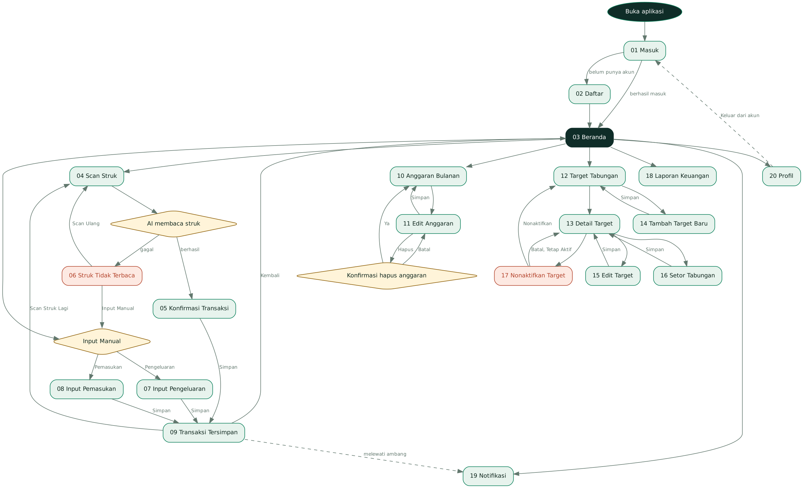

# 🎨 SaveSmart AI — Dokumentasi UI/UX Design

Dokumentasi peran **UI/UX Designer** pada project **SaveSmart AI** (Manajemen Proyek — Kelompok 2).

## 📌 Daftar Isi

1. [Identitas Peran](#1--identitas-peran)
2. [Ringkasan Produk](#2--ringkasan-produk)
3. [Struktur Repository](#3--struktur-repository)
4. [Proses UI/UX](#4--proses-uiux)
5. [Design System](#5--design-system)
6. [Komponen UI](#6--komponen-ui)
7. [Layout & Responsive](#7--layout--responsive)
8. [Daftar 20 Layar](#8--daftar-20-layar)
9. [User Flow](#9--user-flow)
10. [UX Writing & Aksesibilitas](#10--ux-writing--aksesibilitas)
11. [Handoff ke Frontend](#11--handoff-ke-frontend)
12. [Checklist Deliverable](#12--checklist-deliverable)

---

## 1. 👤 Identitas Peran

| Item | Keterangan |
|---|---|
| **Role** | UI/UX Designer |
| **Nama** | Abdullah Duwi Putro |
| **Tools** | Figma, Jira, GitHub |
| **Tim** | PM: Nur Sidik Zainu Ahmad · Frontend: Syah Jehan Wonopatih, Afdan Aiman Saputra · QA: Betrand Hanafi Satria F. |
| **Tahap metodologi** | Planning → **Design UI/UX** → Development → Testing → Deployment |

**Tanggung jawab:** membuat user flow, wireframe, mockup, dan prototype di Figma; menyusun design system; mendesain semua state layar (normal, kosong, loading, error, sukses); handoff ke Frontend dan review hasilnya; mendokumentasikan keputusan desain.

---

## 2. 💡 Ringkasan Produk

**SaveSmart AI** adalah sistem pencatatan finansial dan tabungan otomatis berbasis AI Vision untuk mahasiswa dan pekerja muda yang ingin mengatur uang dengan sederhana lewat HP.

| Fitur | Tantangan UX |
|---|---|
| **Smart Receipt Scanner** | Foto struk jadi transaksi dengan langkah minimal, tetap aman bila AI gagal membaca. |
| **Budget Overspend Alert** | Peringatan terasa membantu, bukan menakutkan (amber lalu merah). |
| **Savings Goal Planning** | Progres dan rencana setoran jelas dan memotivasi. |
| **Financial Dashboard** | Saldo, pemasukan, pengeluaran, dan progres tabungan terbaca sekali lihat. |

**Prinsip desain:** Sederhana · Menenangkan (hijau zamrud) · Suportif · Aman dari salah (ada konfirmasi) · Responsif.

---

## 3. 🗂️ Struktur Repository

```text
ManajemenProyek-Kelompok2/
├── DESIGNER/        <-- README ini + assets/
├── Docs/
├── Frontend/        (React + Vite)
│   ├── index.html   -> Font Inter, theme-color
│   └── src/
│       ├── styles.css  -> Design token & gaya
│       ├── ui.jsx      -> Komponen UI & layout
│       ├── App.jsx     -> Peta rute
│       └── screens/    -> Auth, Main, Scan, Budget, Goals, Profile
├── Backend/
├── Database/
├── QA/
└── Deployme/
```

| Layar | File |
|---|---|
| 1–2 Masuk, Daftar | `screens/Auth.jsx` |
| 3–5 Beranda, Laporan, Notifikasi | `screens/Main.jsx` |
| 6–11 Scan struk & input manual | `screens/Scan.jsx` |
| 12–13 Anggaran | `screens/Budget.jsx` |
| 14–19 Target tabungan | `screens/Goals.jsx` |
| 20 Profil & logout | `screens/Profile.jsx` |

---

## 4. 🪜 Proses UI/UX

| Step | Kegiatan | Output |
|---|---|---|
| 1 | **Discovery** — pahami kebutuhan dan 4 fitur utama bersama PM | Ringkasan kebutuhan |
| 2 | **User Flow** — menu utama: Beranda, Anggaran, Scan Struk, Target, Profil; sekunder: Laporan, Notifikasi | Sitemap, user flow (`assets/04-user-flow.png`) |
| 3 | **Prototype** interaktif di Figma | Link Figma: `https://www.figma.com/design/9iK1EAV2IyI0KEFbzlpExg/Untitled?node-id=0-1&m=dev&t=DZj9xJ1B577QIk2Y-1` |

---

## 5. 🎛️ Design System


### 5.1 Warna

| Token | Hex | Dipakai untuk |
|---|---|---|
| `--brand` | `#0A7F5A` | Tombol primer, link, menu aktif |
| `--brand-d` | `#086847` | Hover tombol primer |
| `--dark` | `#0F2D28` | Kartu saldo, panel kiri Masuk/Daftar, toast |
| `--dark-2` | `#1F4A40` | Kartu di atas latar gelap, pill |
| `--lime` | `#D8F57E` | Aksen di atas gelap (tombol Scan Struk, progress) |
| `--mint` | `#E7F3ED` | Menu aktif, chip, kartu info, area unggah |
| `--bg` | `#F4F7F5` | Latar halaman |
| `--card` | `#FFFFFF` | Latar kartu |
| `--line` | `#E2EAE5` | Border |
| `--ink` | `#10281F` | Teks utama |
| `--muted` | `#62786E` | Teks sekunder |
| `--amber` / `--amber-bg` | `#8A5A00` / `#FFF4D9` | Peringatan |
| `--red` / `--red-bg` | `#B3432B` / `#FDE9E2` | Bahaya, error, hapus |

**Status:** Aman = hijau · Hampir habis = amber · Melebihi batas = merah (selalu disertai teks dan ikon).


### 5.2 Tipografi

Font **Inter** (400, 500, 600, 700), fallback `system-ui, -apple-system, Segoe UI, Roboto, sans-serif`. Dasar 14px / line-height 1.45.

| Elemen | Ukuran |
|---|---|
| H1 | 26px semibold (22px di HP) |
| H2 / H3 | 17px / 16px semibold |
| Angka saldo | 30–34px semibold |
| Eyebrow / caption | 10.5px kapital, spasi 0.06–0.07em |
| Hint | 12px |


### 5.3 Bentuk & jarak

| Item | Nilai |
|---|---|
| Radius | Kartu 14px · tombol/input 10px · modal 16px · chip/badge 7px |
| Tinggi | Tombol 42px (lg 46px, HP 44–48px) · input 44px |
| Padding kartu | 22×24px (16–18px di HP) |
| Gap grid | 18px (14px di HP) |
| Elevasi | Border 1px `--line`; shadow hanya untuk toast, modal, drawer |

### 5.4 Ikon & logo

- **Ikon:** outline, stroke 1.8px, ujung membulat, 12–22px (home, budget, scan, target, user, chart, bell, logout, plus, check, alert, upload, camera, download, dll.).
- **Logo:** persegi membulat `--brand` berisi **S**, teks **SaveSmart** + superskrip **AI**. Versi light: mark lime dan teks putih.


---

## 6. 🧩 Komponen UI

| Komponen | Varian / state |
|---|---|
| **Button** | `primary`, `outline`, `lime` (hanya di latar gelap), `danger` (aksi merusak), `ghost`; hover, disabled, loading |
| **Badge** | `green`, `amber`, `red`, `dark` |
| **Chip** | Kategori transaksi (latar mint) |
| **Progress** | `green`, `amber`, `red`, `lime`; tinggi 8px |
| **Field / Input / MoneyInput / Select** | normal, focus, disabled, error; MoneyInput `Rp 0` dengan format ribuan; font 16px di HP |
| **Segmented** | Minggu/Bulan/Tahun, Pengeluaran/Pemasukan, Semua/Belum dibaca |
| **Radio card, Checkbox, Toggle** | Ambang peringatan 70/80/90%; toggle 40×22px |
| **Card** | `default`, `dark`, `mint`, `amber` |
| **Banner** | `amber`, `red` |
| **Tabel transaksi** | Desktop 3 kolom, HP jadi daftar 2 baris |
| **Grafik batang** | Sumbu Y rapi, bar tertinggi warna penuh |
| **Stepper** | 01 Unggah / 02 Konfirmasi / 03 Selesai |
| **Dropzone** | normal, drag-over, ada gambar |
| **State box** | kosong, loading, error (+ tombol "Coba lagi") |
| **Modal** | Tengah di desktop, bottom sheet di HP; tutup dengan Esc/klik luar |
| **Toast** | sukses (gelap), error (merah tua) |
| **Sidebar / Drawer / Topbar** | Sidebar 232px (200px tablet); drawer di HP; topbar sticky dengan breadcrumb, bulan, lonceng, avatar |


---

## 7. 📱 Layout & Responsive

```text
┌────────────┬───────────────────────────────────────────────┐
│  Sidebar   │  Topbar: crumb · bulan · 🔔 · avatar          │
│  232px     ├───────────────────────────────────────────────┤
│ • Beranda  │  Judul halaman + aksi                         │
│ • Anggaran │  Konten (maks. 1240px, grid kartu)            │
│ • Scan     │                                               │
│ • Target   │                                               │
│ • Profil   │                                               │
│ • Laporan  │                                               │
│ • Notifikasi                                               │
│ • Keluar   │                                               │
└────────────┴───────────────────────────────────────────────┘
```

| Lebar | Perubahan |
|---|---|
| **> 1100px** | Layout penuh, sidebar 232px |
| **≤ 1100px** | Sidebar 200px, grid `home`, `2-1`, `form` jadi 1 kolom |
| **≤ 900px** | Sidebar → hamburger + drawer; panel kiri Masuk/Daftar disembunyikan |
| **≤ 760px** | Semua grid 1 kolom, tabel jadi daftar, tombol aksi penuh lebar |
| **≤ 600px** | Modal jadi bottom sheet |
| **≤ 420px / 380px** | Padding dan font dikecilkan, tombol dua kolom ditumpuk |

**Mobile:** target sentuh min. 40–44px, font input 16px (hindari auto-zoom iOS), hormati `safe-area-inset`, unggah struk lewat kamera (`capture="environment"`).


---

## 8. 🖼️ Daftar 20 Layar

| # | Layar | Isi utama & state | Gambar |
|---|---|---|---|
| 1 | **Masuk** | Split layout (kiri gelap + kartu target, kanan form); email, kata sandi, "Ingat saya", "Lupa kata sandi?". State: error per field/umum, loading | `01-Masuk.png` |
| 2 | **Daftar** | Nama, email, kata sandi (min. 8 karakter), checkbox Syarat & Ketentuan. Validasi inline | `02-Daftar.png` |
| 3 | **Beranda** | Kartu saldo + tombol lime Scan Struk, pemasukan, pengeluaran, banner anggaran, transaksi terbaru, progres target. Pilih bulan, Input Manual. State: loading, error, kosong | `03-Beranda.png` |
| 4 | **Laporan** | Switch Minggu/Bulan/Tahun, 3 kartu statistik, grafik batang, pengeluaran per kategori, **Unduh Laporan** (CSV) | `18-Laporan keuangan.png` |
| 5 | **Notifikasi** | Filter Semua/Belum dibaca, grup Hari ini/Kemarin/Sebelumnya, Tandai Semua Dibaca | `19-Notifikasi.png` |
| 6 | **Scan Struk (Unggah)** | Stepper, dropzone, tombol kamera, panduan 3 langkah, link Input Manual. Maks. 10 MB. State: drag-over, pratinjau, membaca | `04-Scan struk.png` |
| 7 | **Konfirmasi Transaksi** | Pratinjau struk + form (toko, tanggal, kategori, item, total), badge Akurasi AI. AI hanya mengusulkan | `05-Konfirmasi transaksi.png` |
| 8 | **Struk Tidak Terbaca** | Penjelasan, tips foto, **Scan Ulang** / **Input Manual**, "Tidak ada transaksi yang tersimpan" | `06-Struk tidak terbaca.png` |
| 9 | **Input Pengeluaran** | Nominal, tanggal (maks. hari ini), kategori, catatan. Kategori: Makanan, Transport, Hiburan, Belanja, Tagihan, Kesehatan, Pendidikan, Lainnya | `07-Input pengeluaran.png` |
| 10 | **Input Pemasukan** | Kategori: Uang Saku, Gaji, Bonus, Hadiah, Lainnya; judul berubah "Pemasukan baru" | `08-Input pemasukan.png` |
| 11 | **Transaksi Tersimpan** | Ringkasan transaksi, peringatan anggaran bila melewati ambang, Scan Struk Lagi / Beranda | `09-Transaksi tersimpan.png` |
| 12 | **Anggaran Bulanan** | Navigasi bulan, total terpakai, kartu per kategori (Aman / Hampir habis / Melebihi batas), Edit/Hapus. State: kosong, modal Hapus | `10-Anggaran bulanan.png` |
| 13 | **Atur / Edit Anggaran** | Kategori, batas bulanan, ambang 70/80/90%, panel "Kondisi saat ini" | `11-Edit anggaran.png` |
| 14 | **Target Tabungan** | Statistik, kartu target (utama berlatar gelap), filter aktif/nonaktif. State: kosong | `12-Target tabungan.png` |
| 15 | **Detail Target** | Terkumpul, progress, tenggat/fleksibel, rencana setoran, Riwayat Setoran. Aksi: Setor, Edit, Nonaktifkan | `13-Detail target.png` |
| 16 | **Tambah Target** | Nama, nominal, tabungan awal, tercapai dalam (bulan), perkiraan selesai otomatis, opsi fleksibel | `14-Tambah target baru.png` |
| 17 | **Edit Target** | Seperti Tambah, kolom "Sudah terkumpul" terkunci | `15-Edit target.png` |
| 18 | **Setor Tabungan** | Nominal, tanggal (maks. hari ini), catatan, ringkasan sebelum/sesudah, toast sukses | `16-Setor tabungan.png` |
| 19 | **Nonaktifkan Target** | Konfirmasi dengan jaminan (saldo & riwayat aman, bisa diaktifkan lagi); **Batal, Tetap Aktif** / **Nonaktifkan Target** | `17-Nonaktifkan target.png` |
| 20 | **Profil & Logout** | Info pribadi, preferensi (bahasa, IDR, periode), keamanan (Ubah Kata Sandi), 3 toggle notifikasi, Keluar | `20-Profil.png` |
| 21 | **WIREFRAME DESIGN** | `untitled.png` |

Semua gambar berada di `./assets/` (contoh: ``).


---

## 9. 🔀 User Flow

```text
Onboarding:  Masuk ──(belum punya akun)──→ Daftar ──→ Beranda
                └──(sudah punya akun)────────────────→ Beranda

Scan struk:  Beranda/Scan → Unggah foto → AI membaca
                ├─ Berhasil → Konfirmasi → Simpan → Transaksi Tersimpan
                │                                    (+ peringatan anggaran)
                └─ Gagal → Struk Tidak Terbaca → Scan Ulang ↺ / Input Manual

Anggaran:    Anggaran → Atur Anggaran (kategori, batas, ambang) → Simpan
                     → Edit / Hapus (konfirmasi)
             Transaksi melewati ambang → Banner Beranda + Notifikasi

Target:      Target → Tambah → Detail → Setor → Riwayat Setoran
                                     → Edit
                                     → Nonaktifkan → (bisa Aktifkan kembali)
             Progres 25/50/75/100% → Notifikasi target
```

 / | `04-user-flow.png` |

---

## 10. ✍️ UX Writing & Aksesibilitas

**UX Writing** — Bahasa Indonesia, santai tapi sopan (kata ganti "kamu").

| Prinsip | Contoh |
|---|---|
| Menyemangati | "Langkah kecil hari ini. Masa depan lebih terencana." |
| Menenangkan saat peringatan | "Anggaran Makanan hampir habis … Yuk, atur pengeluaran berikutnya." |
| Jelas saat gagal | "Foto terlalu gelap atau buram. Coba lagi dengan cahaya yang cukup, atau isi transaksi secara manual." |
| Menjamin keamanan | "Tabunganmu tetap aman." |
| Memberi kendali | "Kamu tetap memegang kendali." |
| Tombol berupa kata kerja | Masuk, Daftar, Scan Ulang, Setor, Nonaktifkan Target |
| Aksi merusak dibedakan | Tombol merah + konfirmasi "Batal, Tetap Aktif" |

**Aksesibilitas**

- Fokus keyboard: outline hijau 2px (`:focus-visible`).
- ARIA: ikon `aria-hidden`; tombol ikon `aria-label`; toggle `role="switch"`; modal `role="dialog"`; menu aktif `aria-current="page"`; segmented `role="tablist"`; error `role="alert"`; spinner `role="status"`.
- Modal dan drawer bisa ditutup dengan **Esc**; scroll dikunci saat drawer terbuka.
- Status tidak hanya bergantung warna (selalu ada teks dan ikon). Target sentuh 40–48px. `<html lang="id">`.
- ⚠️ Cek ulang kontras `--muted` (`#62786E`) pada teks kecil di atas `--mint` dan `--bg` (target WCAG AA 4.5:1).

---

## 11. 🤝 Handoff ke Frontend

| Di Figma | Di kode |
|---|---|
| Color style | Variabel CSS `:root` di `styles.css` |
| Text style | `h1`, `h2`, `h3`, `.eyebrow`, `.sub`, `.muted` |
| Tombol | `<Button variant="primary \| outline \| lime \| danger">` |
| Badge | `<Badge tone="green \| amber \| red \| dark">` |
| Progress | `<Progress value tone dark />` |
| Input | `<Field>`, `<Input>`, `<MoneyInput>`, `<Select>` |
| Segmented / Modal | `<Segmented>`, `<Modal title actions>` |
| Layout | `<Layout active crumb>` + `<PageHead title subtitle>` |
| Kosong / loading / error | `<Empty>`, `<Spinner>`, `<ErrorBox>`, `<Load>` |
| Frame desktop 1440 | Kelas grid `.g-home`, `.g-2-1`, `.g-3`, dll. |

**Rute (hash router):** `#/home`, `#/report`, `#/notifications`, `#/scan`, `#/manual`, `#/budget`, `#/budget-edit`, `#/goals`, `#/goal-detail/:id`, `#/goal-new`, `#/goal-edit/:id`, `#/goal-deposit/:id`, `#/goal-deactivate/:id`, `#/profile`.

**Catatan developer**

1. Jangan pakai warna di luar token; ajukan ke designer bila perlu warna baru.
2. Nominal dalam format Rupiah (`Rp 4.200.000`); pengeluaran negatif, pemasukan positif berwarna hijau.
3. Setiap layar berisi data wajib punya state loading, error, dan kosong.
4. Aksi merusak (hapus, nonaktifkan, keluar) wajib lewat konfirmasi.
5. Tes tampilan di lebar 1440, 1024, 768, 390, dan 360px.

**Checklist design review per layar:** warna & font sesuai · jarak & radius sesuai · state lengkap · responsif tanpa scroll horizontal · UX writing sesuai · fokus keyboard terlihat · konfirmasi aksi merusak.

---

## 12. ✅ Checklist Deliverable

| # | Deliverable | Lokasi | Status |
|---|---|---|---|
| 2 | user flow | `assets/04-user-flow.png*` | ✅ |
| 3 | Wireframe | `assets/untitled.png*` | ✅ |
| 6 | Mockup 20 layar (desktop) | `assets/01` s/d `20` | ✅ |
| 8 | Prototype Figma | link di Step 7 | ✅ |
| 9 | Hasil usability check | bagian 4, step 8 | ✅ |


---

## 📎 Tautan Terkait

| Sumber | Tautan |
|---|---|
| Repository | https://github.com/Nur-Sidik/ManajemenProyek-Kelompok2 |
| Figma | *(https://www.figma.com/design/9iK1EAV2IyI0KEFbzlpExg/Untitled?node-id=0-1&p=f&t=quk6lyndV3638lHv-0)* |
| README Frontend | [`../Frontend/README.md`](../Frontend/README.md) |
| README Backend | [`../Backend/README.md`](../Backend/README.md) |

---

<p align="center"><b>SaveSmart AI</b> — Dirancang oleh UI/UX Designer · Kelompok 2 Manajemen Proyek</p>